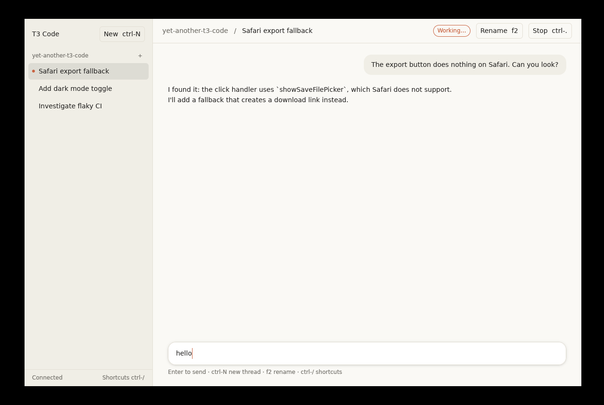
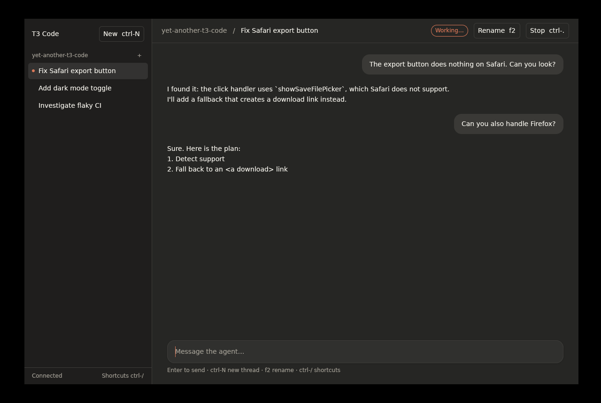

# YATT: Yet Another T3 Code

(예전 이름은 YAT3입니다. 이미 `yat3` cask를 설치했다면 `brew update && brew upgrade`로 `yatt`로 옮겨지고, 설정 폴더도 처음 실행할 때 옮겨집니다.)

[T3 Code](https://github.com/pingdotgg/t3code)를 [GPUI](https://www.gpui.rs/)(Zed의 Rust UI 프레임워크)로 다시 만든 네이티브 클라이언트입니다. 에이전트 실행, 스레드 저장, 프로바이더 연결은 T3 Code 서버를 Go로 옮긴 `yatt-server`(`server/`)가 처리하며, 이 서버가 앱 안에 들어 있습니다. 앱은 서버의 WebSocket RPC에 접속해서 스레드를 보여 주고 명령을 보냅니다. 서버는 T3 Code와 같은 프로토콜을 쓰므로, 다른 컴퓨터에서 실행 중인 T3 Code 서버에도 연결할 수 있습니다.

| 라이트 | 다크 |
|---|---|
|  |  |

## 현재 되는 것

- 프로젝트 추가 (사이드바의 Add 버튼이나 `Cmd-Shift-O`로 폴더 선택)
- 프로젝트별 스레드 목록 (진행 중인 스레드와 답변을 기다리는 스레드는 점으로 표시)
- **섹션**: `Cmd-Shift-S`로 열린 스레드를 섹션에 넣습니다. 헤더에 이름을 입력하는 칸이 열리고, Tab을 누르면 이미 있는 섹션 이름이 차례로 채워지며, 비운 채 Enter를 누르면 섹션에서 뺍니다. 섹션이 없는 스레드가 맨 위에, 그 아래로 섹션이 이름순으로 표시됩니다. 섹션 제목을 누르거나 `Cmd-Alt-S`(열린 스레드의 섹션)를 누르면 접고 펼 수 있고, 접힌 상태는 설정 폴더의 `sidebar.json`에 남습니다.
- **정리(settle)**: `Cmd-E`로 열린 스레드를 settle하면 맨 아래 Settled 섹션으로 옮겨지고, 다시 누르면 원래 섹션으로 돌아옵니다. 자동 settle은 없어서 사용자가 settle한 스레드만 옮겨지며, settle한 스레드에 메시지를 보내면 다시 원래 섹션으로 돌아옵니다. Settled 섹션은 처음에 접혀 있고 `Cmd-Shift-E`로 펼칩니다.
- 대화 보기와 실시간 스트리밍, 메시지 보내기 (실행 중이면 대기열에 추가)
- 새 스레드 시작 (같은 프로젝트에서 최근에 쓴 모델과 실행 모드를 재사용하고, 처음에는 Codex 기본 모델을 사용). 제목은 첫 메시지를 보고 Codex가 지어 줍니다.
- **모델 선택**: 새 스레드를 시작할 때 입력창 아래의 모델 버튼이나 `Cmd-Shift-M`으로 Codex 모델(GPT-6 Astra, GPT-6.1 Sol, GPT-6 Luna)과 Claude 모델(Opus 5.5, Sonnet 5.5, Fable 5.2, Haiku 5.5)을 차례로 바꿉니다. 이미 시작한 스레드는 처음 고른 모델을 계속 씁니다.
- **worktree 스레드**: 새 스레드를 시작할 때 입력창 아래의 Project folder 버튼이나 `Cmd-Alt-W`로 New worktree를 고르면, 서버가 현재 HEAD에서 임시 브랜치(`t3/…`)를 만들고 `~/.yatt/server/worktrees/<저장소>/` 아래에 git worktree를 만든 뒤 그 안에서 에이전트를 실행합니다. 열린 스레드는 입력창 아래에 브랜치를 표시합니다.
- **스레드 이름 변경**: `F2`, 헤더의 Rename 버튼, 제목이나 목록 항목 더블클릭
- **변경 내용 보기**: 헤더의 Changes 버튼이나 `Cmd-Shift-D`로 스레드가 바꾼 파일의 diff를 오른쪽 패널에 엽니다. 처음에는 방금 끝난 턴(이번 턴)의 변경을 보여 주고, `Cmd-Alt-D`를 누르면 모든 턴의 변경을 합쳐서 봅니다. 에이전트가 턴 도중에 스스로 만든 git worktree(`git worktree add`, Claude Code의 worktree 등)의 변경도 "Worktree <브랜치>" 제목 아래에 함께 표시됩니다. 턴이 끝나면 자동으로 갱신됩니다.
- **PR 보기**: 스레드 폴더나 에이전트가 만든 worktree의 브랜치에 PR이 있으면 헤더에 `PR #번호 open` 같은 버튼이 나오고, 변경 패널 위쪽에 PR 목록이 나옵니다. `Cmd-Alt-P`로 첫 PR을 브라우저에서 엽니다. PR은 GitHub CLI(`gh`)로 찾으므로 `gh auth login`이 되어 있어야 하며, 턴이 끝날 때마다 다시 확인합니다.
- **첨부 파일**: 입력창의 Attach 버튼이나 `Cmd-Shift-A`로 이미지나 파일을 고르면 서버로 바로 올라가고, 메시지를 보낼 때 함께 전달됩니다. 이미지는 에이전트에게 이미지로 전달되고, 다른 파일은 서버에 저장된 경로가 메시지에 붙습니다. 칩의 ✕를 누르면 올린 파일을 지웁니다.
- **터미널**: `Cmd-J`(또는 `` Ctrl-` ``)로 열린 스레드의 터미널을 아래쪽에 엽니다. 셸은 서버가 스레드의 worktree나 프로젝트 폴더에서 실행하므로, 패널을 닫거나 다른 스레드로 옮겨도 계속 실행되고 다시 열면 이전 출력이 보입니다. `Cmd-K`는 화면을 비우고, 셸이 끝나면 Enter로 새 셸을 시작합니다.
- 실행 중지, 스레드 보관
- 승인 요청에 답하기 (승인, 이 세션 동안 승인, 거절)와 에이전트의 질문에 보기를 고르거나 입력창 내용으로 답하기
- 단축키와 색상, 글꼴을 설정 파일로 변경 (재시작 없이 다시 불러오기 가능)

아직 없는 것: 시작한 스레드의 모델 변경, Markdown 렌더링, 메시지 텍스트 선택. 입력창은 한 줄입니다.

## 설치

### Homebrew (macOS Apple silicon)

```sh
brew tap jadewisemann/yatt https://github.com/jadewisemann/yet-another-t3-code
brew install --cask yatt
```

Homebrew 설치만으로 끝나며, T3 Code 앱이나 Node.js를 따로 설치할 필요가 없습니다. 에이전트로 쓸 Codex CLI(`codex`)나 Claude Code(`claude`)는 따로 설치하고 로그인해 두어야 합니다. 업데이트는 `brew upgrade --cask yatt`로 합니다. 설치하면 `/Applications/YATT.app`과 터미널용 `yatt` 명령이 함께 생깁니다. 앱은 개발자 서명 없이 ad-hoc 서명만 되어 있으므로, cask가 설치 직후 격리 속성(quarantine)을 지워서 바로 열리게 합니다.

새 버전은 `Cargo.toml`의 `version`을 올려 main에 병합하면 배포됩니다. `Release` 워크플로가 macOS 앱을 빌드해 GitHub Release를 만들고, `Casks/yatt.rb`의 버전과 sha256을 자동으로 갱신합니다.

### 직접 빌드

Rust stable, Go(버전은 `server/go.mod`), Xcode Command Line Tools가 있으면 됩니다. (Metal 셰이더를 실행 시점에 컴파일하므로 Xcode 전체는 필요하지 않습니다.)

```sh
cargo build --release
scripts/bundle-macos.sh        # yatt-server를 빌드해 넣은 target/release/YATT.app 생성
```

## 서버와 연결하기

### 같은 Mac (기본, 자동)

macOS 앱 안에 `yatt-server`가 `YATT.app/Contents/Resources/yatt-server`로 들어 있습니다. YATT를 실행하면 이미 실행 중인 `yatt-server`가 있으면 그 서버를 쓰고, 없으면 내장 서버를 빈 포트로 띄운 뒤 앱을 종료할 때 함께 끕니다. 토큰은 `yatt-server auth session issue`로 1년짜리를 발급받으므로 링크를 붙여 넣을 일이 없습니다.

서버 데이터는 `~/.yatt/server`에 저장됩니다(`YATT_SERVER_HOME`으로 변경 가능). T3 Code의 `~/.t3`와는 따로 두므로, 두 서버가 같은 데이터베이스를 건드리지 않습니다. 그래서 T3 Code에서 만든 프로젝트와 스레드는 보이지 않으며, 프로젝트는 YATT에서 다시 추가해야 합니다. 서버 출력은 설정 폴더의 `server.log`에 남습니다. 터미널에서 `yatt pair`를 실행해도 같은 방식으로 연결 정보를 만듭니다.

에이전트로 쓰는 Codex CLI는 `PATH`의 `codex`를 사용합니다(`YATT_CODEX_BIN`으로 변경 가능).

### 다른 컴퓨터의 서버에 연결하는 경우

서버가 실행되는 컴퓨터에서 페어링 링크를 만듭니다.

```sh
yatt-server auth pairing create    # T3 Code 서버라면 `t3 pair`
```

출력된 `http://…/pair#token=…` 링크를 YATT 첫 화면에 붙여 넣고 Enter를 누르면 연결됩니다. 터미널에서 `yatt pair <링크>`로 해도 됩니다. 발급된 토큰은 설정 폴더의 `connection.json`에 저장되며 30일 동안 유효합니다. 만료되면 앱이 다시 페어링 화면을 보여 줍니다.

`T3_SERVER_URL`과 `T3_TOKEN` 환경 변수를 지정하면 저장된 연결 대신 그 값을 사용합니다.

## 설정

설정 폴더는 macOS에서 `~/Library/Application Support/yatt`, Linux에서 `~/.config/yatt`입니다 (`YATT_CONFIG_DIR`로 변경 가능, 이전 이름 `YAT3_CONFIG_DIR`도 인식). `Cmd-,`로 폴더를 열 수 있고, 파일을 고친 뒤 `Cmd-Shift-,`를 누르면 다시 불러옵니다.

### 단축키: `keymap.json`

Zed와 같은 형식입니다. 기본값 위에 덧붙이며, `null`로 지정하면 그 키의 기본 동작을 없앱니다. `secondary-`는 macOS에서 `cmd`, 그 밖의 OS에서 `ctrl`을 뜻합니다. 예시는 [examples/keymap.json](examples/keymap.json)에 있습니다.

```json
[
  { "context": "Workspace", "bindings": { "cmd-r": "yatt::RenameThread", "f2": null } }
]
```

| 동작 | 이름 | 기본 키 |
|---|---|---|
| 새 스레드 | `yatt::NewThread` | `cmd-n` |
| 프로젝트 추가 | `yatt::AddProject` | `cmd-shift-o` |
| 새 스레드의 모델 바꾸기 | `yatt::CycleModel` | `cmd-shift-m` |
| 새 스레드를 worktree / 프로젝트 폴더에서 시작 | `yatt::ToggleWorktree` | `cmd-alt-w` |
| 파일 첨부 | `yatt::AttachFiles` | `cmd-shift-a` |
| 터미널 보이기 / 숨기기 | `yatt::ToggleTerminal` | `cmd-j`, `` ctrl-` `` |
| 터미널 비우기 (터미널 안에서) | `yatt::ClearTerminal` | `cmd-k` |
| 스레드 이름 변경 | `yatt::RenameThread` | `f2`, `cmd-shift-r` |
| 다음 / 이전 스레드 | `yatt::NextThread` / `yatt::PreviousThread` | `cmd-]` / `cmd-[`, `alt-down` / `alt-up` |
| 입력창으로 이동 | `yatt::FocusComposer` | `cmd-l` |
| 사이드바 표시 전환 | `yatt::ToggleSidebar` | `cmd-b` |
| 변경 내용 패널 열기 / 닫기 | `yatt::ToggleDiff` | `cmd-shift-d` |
| 변경 내용: 이번 턴 / 모든 턴 | `yatt::ToggleDiffScope` | `cmd-alt-d` |
| 실행 중지 | `yatt::StopThread` | `cmd-.` |
| 스레드 보관 | `yatt::ArchiveThread` | `cmd-shift-backspace` |
| 스레드 settle / 되돌리기 | `yatt::ToggleSettled` | `cmd-e` |
| 스레드를 섹션으로 옮기기 | `yatt::MoveToSection` | `cmd-shift-s` |
| 열린 스레드의 섹션 접기 / 펴기 | `yatt::ToggleSection` | `cmd-alt-s` |
| Settled 섹션 보이기 / 숨기기 | `yatt::ToggleSettledSection` | `cmd-shift-e` |
| 스레드의 PR 열기 | `yatt::OpenPullRequest` | `cmd-alt-p` |
| 단축키 목록 | `yatt::ToggleShortcuts` | `cmd-/` |
| 설정 다시 불러오기 | `yatt::ReloadConfig` | `cmd-shift-,` |
| 설정 폴더 열기 | `yatt::OpenConfigFolder` | `cmd-,` |
| 연결 해제 후 다시 페어링 | `yatt::Disconnect` | (메뉴) |

입력창 안의 편집 키(`text_input::Submit`, `text_input::Cancel` 등)도 `"context": "TextInput"`으로 바꿀 수 있습니다.

### 외형: `theme.json`

기본 팔레트는 Claude 앱처럼 따뜻한 중성색과 테라코타 강조색을 씁니다. 지정한 항목만 덮어씁니다. 예시는 [examples/theme.json](examples/theme.json)에 있습니다.

- `mode`: `auto`(시스템 따라감), `light`, `dark`
- `uiFont`, `messageFont`, `codeFont`, `fontSize`: 화면 글꼴, 대화 본문 글꼴(macOS 기본값 Georgia), diff 글꼴(macOS 기본값 Menlo), 기본 크기
- `light`, `dark`: `background`, `sidebar`, `surface`, `border`, `text`, `muted`, `accent`, `accentText`, `selection`, `rowHover`, `rowSelected`, `userBubble`, `danger`, `working`, `added`, `removed` 색상 (`#rgb`, `#rrggbb`, `#rrggbbaa`)

## 구조

| 파일 | 역할 |
|---|---|
| `src/rpc.rs` | Effect RPC 프로토콜 클라이언트 (별도 스레드의 tokio + WebSocket) |
| `src/protocol.rs` | 사용하는 orchestration v2 메시지와 명령 정의 |
| `src/config.rs` | 페어링(토큰 교환)과 연결 정보 저장 |
| `src/local.rs` | 내장 `yatt-server` 실행과 종료, 토큰 발급 |
| `server/` | T3 Code 서버를 Go로 옮긴 `yatt-server` |
| `src/workspace.rs` | 메인 화면 |
| `src/keymap.rs` | 액션 정의, 기본 단축키, `keymap.json` 로더 |
| `src/theme.rs` | 팔레트와 `theme.json` 로더 |
| `src/text_input.rs` | IME를 지원하는 한 줄 입력창 (GPUI 예제 기반) |

서버 프로토콜의 기준은 업스트림 `packages/contracts/src/orchestrationV2.ts`와 `rpc.ts`입니다. 서버가 `orchestrationProtocol` 버전을 올리면 접속이 거부되며(HTTP 426), 그때 이 클라이언트를 갱신해야 합니다.

### 실제 서버 없이 화면 확인하기

```sh
pip install websockets==10.4
python3 scripts/fake-server.py &
T3_SERVER_URL=http://127.0.0.1:3999 T3_TOKEN=x cargo run
```

## Go 서버

`server/`의 `yatt-server`는 T3 Code 서버를 Go로 다시 구현한 것입니다. 업스트림 계약에서 자동으로 뽑은 스펙(`spec/`)과, 업스트림 서버에서 기록한 적합성 시나리오(`conformance/`)를 기준으로 구현합니다. 계획과 단계는 [docs/go-port/PLAN.md](docs/go-port/PLAN.md), 현재 구현 범위는 [spec/coverage.md](spec/coverage.md)에 있습니다. 지금은 YATT가 쓰는 기능(프로젝트, 스레드, Codex와 Claude Code 실행, 대기열, 승인 요청, 제목 생성, 체크포인트, 턴 diff, worktree 스레드, 첨부 파일, 터미널)을 구현했습니다.

## 라이선스와 출처

`src/text_input.rs`는 GPUI의 `examples/input.rs`(Apache-2.0, Zed Industries)를 바탕으로 수정했습니다. `vendor/xattr`는 xattr 0.2.3(MIT/Apache-2.0)에 최신 libc 호환 수정을 한 줄 더한 사본입니다.
